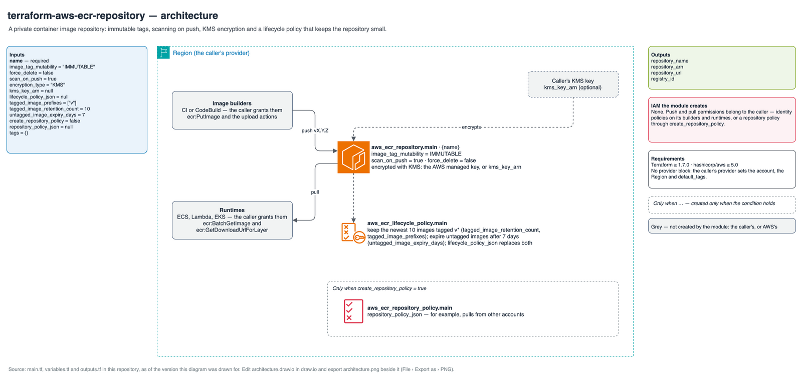

# Reference: resources and permissions

## Diagram

Source: [`architecture.drawio`](architecture.drawio).

## Resources

| Resource | Created when | Name and tags |
| --- | --- | --- |
| `aws_ecr_repository.main` | Always | `var.name`; tag `Name = var.name` plus `var.tags` (a `Name` in `var.tags` wins) |
| `aws_ecr_lifecycle_policy.main` | Always | Policy from `lifecycle_policy_json`, or built from the `tagged_image_*` and `untagged_image_expiry_days` inputs |
| `aws_ecr_repository_policy.main[0]` | `create_repository_policy = true` | `repository_policy_json` as given |

The default lifecycle policy has two rules: priority 1 keeps the
`tagged_image_retention_count` most recent images whose tag starts with one of
`tagged_image_prefixes`; priority 2 expires untagged images
`untagged_image_expiry_days` after push.

## IAM granted by the module

None. With no repository policy, only IAM principals in the owning account whose own
policies allow ECR actions can push or pull. A repository policy, when you supply
one, grants exactly what it says.

## Permissions the caller needs

`ecr:CreateRepository`, `ecr:DeleteRepository`, `ecr:DescribeRepositories`,
`ecr:PutLifecyclePolicy`, `ecr:GetLifecyclePolicy`, `ecr:DeleteLifecyclePolicy`,
`ecr:SetRepositoryPolicy`, `ecr:GetRepositoryPolicy`, `ecr:DeleteRepositoryPolicy`,
`ecr:TagResource`, `ecr:UntagResource`, `ecr:ListTagsForResource`,
`ecr:PutImageScanningConfiguration`, `ecr:PutImageTagMutability`. With a customer
managed key, also `kms:CreateGrant`, `kms:RetireGrant` and `kms:DescribeKey`.

## Requirements

| | Minimum | Why |
| --- | --- | --- |
| Terraform | 1.7.0 | Mocked providers in the test framework |
| `hashicorp/aws` | 5.0 | Tested with 5.0.0 and the latest 6.x |

Inputs and outputs are listed in the [README](../../README.md#inputs).
